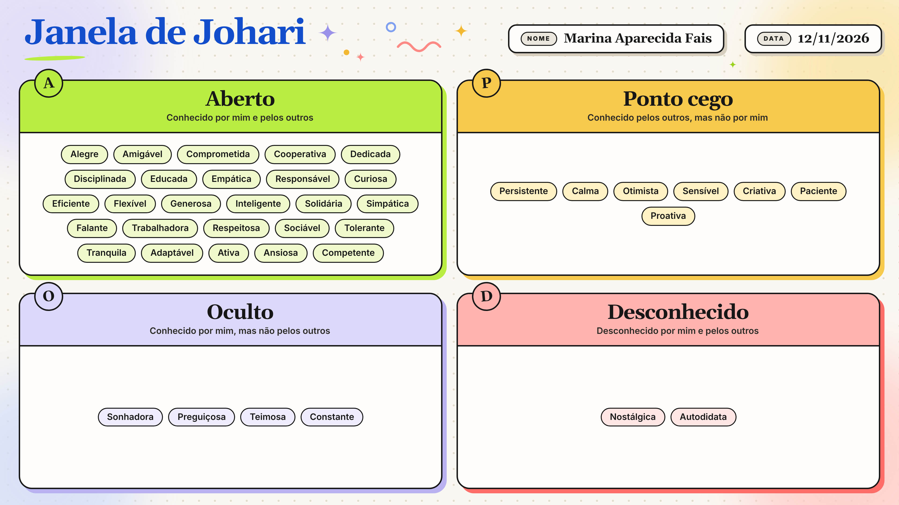

# Janela de Johari

## Sobre o projeto

Este projeto apresenta a **Janela de Johari**, uma ferramenta de autoconhecimento que permite compreender melhor a própria personalidade e como somos percebidos pelas outras pessoas.

A atividade foi dividida em quatro quadrantes:

## Os quatro quadrantes

### Aberto
**Conhecido por mim e pelos outros.**

Características: alegre, amigável, comprometida, dedicada, responsável, curiosa, inteligente, criativa e sociável.

### Ponto Cego
**Conhecido pelos outros, mas não por mim.**

Características: persistente, calma, otimista, sensível, paciente e proativa.

### Oculto
**Conhecido por mim, mas não pelos outros.**

Características: sonhadora, preguiçosa, teimosa e constante.

### Desconhecido
**Desconhecido por mim e pelos outros.**

Características: nostálgica e autodidata.

## Objetivo

- Desenvolver o autoconhecimento;
- Identificar qualidades pessoais;
- Reconhecer características percebidas pelos outros;
- Descobrir habilidades e aspectos que podem ser desenvolvidos.

## Design

O projeto utiliza quatro cores para diferenciar os quadrantes: verde, amarelo, lilás e rosa, com cartões organizados para facilitar a visualização.

## Conclusão

A atividade permitiu refletir sobre minha personalidade, reconhecer minhas qualidades e compreender que sempre existem novas características e habilidades a descobrir.

## Resultado Final

 Resultado final da Janela de Johari.

